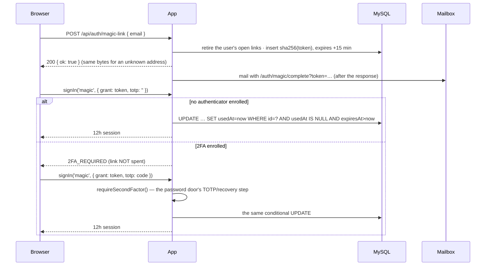

# Magic-link sign-in (#1959)

"Email me a sign-in link" on `/auth/signin`. A mentee who opens the app on their
phone three weeks after registering and cannot remember the password they set
once gets a mailed link instead of a reset dance. The link is the proof of
mailbox control — the same proof the password-reset flow already trusts — so it
is **a password-equivalent credential** and is treated exactly like a password
that verified, minus the bcrypt compare.

## The rules it follows

| Property | How |
|---|---|
| Not an enumeration oracle | the request route answers the same 200 for every address; the mail is sent **after** the response (`after()`), so the known path has no SMTP round-trip to time; refusals (inactive, unverified, pending approval, SSO-enforced tenant) are silent |
| Not readable from a DB dump | only `sha256(token)` is stored (`LoginLinkToken.tokenHash`); the raw value exists in one e-mail and nowhere else — never in a log or an activity-log detail |
| Single use | the admission is **one conditional `updateMany`** (`spendLoginLink`): `WHERE id AND usedAt IS NULL AND expiresAt > now`. Two clicks, two tabs, a leaked URL raced against its owner — exactly one wins |
| Short-lived | 15 minutes (`LOGIN_LINK_TTL_MS`); requesting a new link retires every open one, so only the newest mail works |
| Not a 2FA bypass | an enrolled authenticator is asked for through the **same** `requireSecondFactor()` the password door uses (lockouts, both recovery buckets, the replay floor). The first visit answers `2FA_REQUIRED` without spending the link; a wrong code costs the TOTP bucket, never the link |
| Not a way around enforced SSO | `isPasswordLoginBlocked()` refuses at request time and again at redemption (#1950) |
| Not a way into the other product | `findAccountsForMailedLink()` picks the account of the host the form was served from; the provider runs `assertAccountMatchesHost()` (docs/worlds.md) |
| Rate-limited twice | 5/15 min per IP **and** 5/15 min per address — per-address alone lets one machine spray a list, per-IP alone lets a botnet hammer one mailbox |
| Not a paid feature | no entitlement or plan check anywhere on the path |
| Housekept | spent and expired rows go with the nightly trusted-device purge (03:40) |

## Where the code is

| File | Role |
|---|---|
| `prisma/schema.prisma` | `LoginLinkToken` — user-keyed like `SsoLoginGrant`, no `orgId` (the user row already carries the tenant) |
| `src/lib/magicLinkToken.ts` | the dependency-free rules: TTL, token format, hash-at-rest, liveness — unit-tested in `scripts/test/magic-link-token.test.mjs` |
| `src/lib/magicLink.ts` | the only writer: mint (retiring the old), find by hash, spend (conditional), purge |
| `src/app/api/auth/magic-link/route.ts` | `POST` — the enumeration-safe request door (listed in `scripts/check-auth-reads.mjs` and `scripts/route-auth-baseline.json`) |
| `src/lib/auth.ts` | the `magic` provider, and `requireSecondFactor()` shared with the credentials provider |
| `src/app/auth/magic/*` | request form · `sent` confirmation · `complete` consumer (handles the 2FA step) |
| `src/services/emailService.ts` | `sendMagicLinkEmail()` (category `security`, essential) and the purge call |
| `e2e/magic-link.spec.ts` | request → sign in → reuse refused, the 2FA step, the silent refusals, both rate limits |

## Things that will bite a change here

- **Do not spend the link before the second factor.** Spending it on the first visit
  would make a mistyped TOTP code cost the whole link, and a locked TOTP bucket
  would strand the person with a dead link. The 15-minute expiry is what bounds an
  unspent link sitting at the code prompt.
- **Do not add a second TOTP implementation.** The magic provider calls
  `requireSecondFactor()`; so does the password door. A rule added to one and not
  the other is a downgrade attack on the enrolment.
- **Keep the request route column-scoped.** It is a way back in for a locked-out
  person, so a `Json` column read there can lock them out for good (#1150) —
  `check:auth-reads` guards it.
- **Never return or log the raw token** after the mail. `auth.magic_link_used`
  carries actor and origin only; the e2e asserts the token is in no column.
