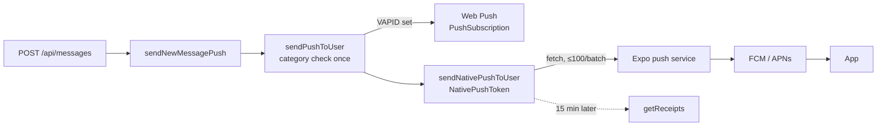

# Native push for the mobile app (#2775)

When a message arrives, the phone shows a notification even while the app is closed.
A tap opens the **native thread** in the product the message belongs to. Android ships
first; nothing in the design is Android-specific, and the missing iOS steps are listed
at the end.

## The shape



- **One payload, two channels.** `sendPushToUser` (`src/lib/webPush.ts`) reads the
  recipient's notification preferences once and sends the same `{ title, body, url, tag }`
  to browsers and to app installs. The two are independent: web push needs VAPID keys;
  native push needs nothing. A deployment without VAPID still reaches phones, so
  `sendNewMessagePush` no longer returns early on `pushConfigured()`.
- **Never throws.** Like web push, every path is best-effort. A push service that is down
  cannot fail the message that triggered it.
- **Expo is only the delivery hop.** One HTTPS endpoint fronts FCM and APNs, so the server
  never knows which platform a token is on. It is called with plain `fetch`; the SDK would
  add a dependency for two POSTs.

## Data model: `NativePushToken`

| Field | |
|---|---|
| `userId` | the `User` **row**, `onDelete: Cascade`. No `orgId`, the same as `PushSubscription`: a row already lives in one world ([`worlds.md`](worlds.md)), and the model is not a tenant model (`check:tenant-models` only governs models with an `orgId`). |
| `token` | `ExponentPushToken[…]`. It is a delivery credential: never selected for the /account list, never returned. |
| `host` | the served hostname the app registered on, taken from the **request**, never from the body. It comes back as `data.host`. |
| `platform`, `appVersion` | display only |
| `lastSeenAt` | moved by the app's launch-time refresh. A delivery does not move it: Expo accepting a message says nothing about the phone. |
| `failureCount` | the same 5-strike ceiling as `PushSubscription` |

**Unique on `(token, host)`, not on `token`.** One phone has one Expo token for the whole
app. Someone signed in to both products on that phone has two `User` rows on two hosts.
A token-unique key would let the second sign-in take over the first product's row. Within
one host, a phone holds one account, so a sign-in by somebody else on the same product
takes the row over. This is `PushSubscription`'s endpoint rule. Expo tokens are random
and never exposed, as web push endpoints are.

The table is new and has no required column without a database default, so
`db push` applies it to a populated database (`npm run check:schema-push`).

## Server

**`POST /api/push/native`** `{ token, platform: 'android'|'ios', appVersion?, refresh? }`
- Needs a session.
- Rate limit: bucket `push-native`, 20 per 15 min.
- Answers `{ registered }`.
- Without `refresh`, it upserts the row, so the request is also a takeover.
- With `refresh: true`, it only re-confirms an existing row of this account on this host.
  It answers `registered: false` when there is none, and creates nothing.

**`DELETE /api/push/native`** `{ token }`
- Needs a session.
- Deletes only the caller's row on this host.
- Idempotent, and answers `{ removed }`.
- Knowing someone else's token silences nobody.

**Delivery** (`src/lib/expoPush.ts`; rules in `src/lib/expoPushRules.ts`, unit-tested in
`scripts/test/expo-push.test.mjs` with a mocked `fetch`):
- Batches of 100. A whole-request failure (network, 5xx, `PUSH_TOO_MANY_*`) counts as one
  failure for every row in that batch.
- `DeviceNotRegistered`, on a ticket or on a receipt, deletes the row at once.
- Any other ticket or receipt error increments `failureCount`. At 5 the row goes.
- A receipt that reads `ok` resets the count. A missing receipt is not evidence either way.
- Receipts are read 15 minutes after the send, with an in-process `setTimeout(...).unref()`.
  A restart in between loses that one check. The next send to a dead token produces a new
  receipt, so the system heals itself. A durable job is deliberately not used: the queue
  has no handlers wired yet (`src/lib/jobs/types.ts`).
- The message is `{ to, title, body, data: { url, host }, sound, priority: 'high', ttl: 12h,
  channelId: 'messages', tag, collapseId }`. `tag`/`collapseId` collapse a burst in one
  thread into one tray entry. `url` stays **relative**; the reasoning is the same as for
  web push (`PushPayload.url`).

**Revocation.**
- `revokeAllTrustedDevices` and `revokeTrustedDevicesForUsers` (`src/lib/trustedDevice.ts`)
  also delete the account's native tokens. Every path that stamps `sessionsValidFrom` calls
  one of them: password change or reset, sign out everywhere, admin sign-out-all, 2FA reset,
  deactivation, the enforced-SSO sweep, and erasure. A signed-out phone therefore stops
  showing that account's messages, and the next revoking path cannot forget the pairing.
- /account lists app installs ("App on Android") next to browsers, through the same
  `GET/DELETE /api/push/subscribe?id=` (`src/lib/pushDevices.ts`).
- The retention rule for stale push subscriptions covers native tokens with the same
  window and the same condition: the row was not seen for 180 days **and** the owner
  has not signed in for 180 days.

**`EXPO_ACCESS_TOKEN`** (optional, server only):
- Turn on "Enhanced push security" for the Expo project first; Expo then rejects any send
  without the token.
- It lives in the server env files: `/etc/internship-crm/prod.env` for prod, and
  `/etc/internship-crm/preview.env` for preview **and every topic env**.
- `infra/deploy-prod.sh` and `infra/server/topic-deploy.sh` forward it explicitly; a
  variable missing from those `-e` lists never reaches the container.
- Not a GitHub secret: the deploy reads the env file on the box.

## App (`apps/mobile`)

| File | Role |
|---|---|
| `src/lib/push.ts` | Pure rules, with `push.test.ts`: payload parsing, host → product, tap plan, foreground rule, register-vs-refresh, ask-once |
| `src/lib/pushDevice.ts` | expo-notifications glue: handler, channel, permission, token, `registerPush` / `unregisterPush` |
| `src/components/PushBridge.tsx` | Mounted once in the root layout: registration, tap routing, active host |

- **Permission.** It is asked once per install, after the first signed-in launch. The app
  first shows a short native explanation, then the system prompt (`POST_NOTIFICATIONS` on
  Android 13+). "Not now" is never asked again; the phone's settings remain the way back.
  Android 12 and older grant it without a prompt.
  - The channel `messages` is created only **after** the person says yes to the
    explanation, or once permission is already granted. Creating the first channel can make
    Android show its own prompt on the spot, and then the explanation never appears; the
    emulator test caught exactly that (#2775).
- **Registration.** It runs whenever the app is signed in to a product: after a sign-in,
  at launch, after a product switch, and on a token change (`addPushTokenListener`).
  - On Android, expo-notifications fires `onDevicePushToken` on **every** token fetch,
    `getExpoPushTokenAsync` included (`PushTokenModule.kt` calls `onNewToken` after each
    fetch; re-checked in expo-notifications 58.1, SDK 58). A listener that re-registers on
    every event therefore loops: about 24 requests a second on the emulator.
    `deviceTokenEvent()` (`push.ts`) records the first token and re-registers only when a
    later one differs, and `registerPush` runs one registration per host at a time.
  - The token last registered on each host is kept in AsyncStorage.
  - A **sign-in** or a **different token** registers (create or take over).
  - The **same token** only refreshes. A phone revoked on /account therefore stays revoked
    until the next sign-in, instead of re-adding itself on every launch.
  - A row pruned after 5 transient failures also waits for the next sign-in. This is a
    known trade-off; the case is rare.
- **Sign-out.** `DELETE /api/push/native` runs **first**, while the session can still
  authorise it. Then the remembered device is revoked, then the session ends. This is
  `signOutEverywhere()`'s order. Only that product's row goes; the other product keeps
  notifying.
  - "Switch product" is not a sign-out and unregisters nothing. Both signed-in products
    keep notifying; that is the point of `data.host`.
  - An offline sign-out leaves the row. Notifications keep arriving until the product is
    signed in again on that phone (a takeover) or the token dies. A tap lands on sign-in.
- **Foreground.** The handler shows no banner for the thread on screen in its own product.
  That thread reloads at once instead. The tab badges refresh on every push received.
  - Since SDK 58, expo-notifications shows a foreground notification by default and no
    longer drops one whose handler is slower than 3 seconds. The handler in
    `pushDevice.ts` answers every push explicitly, so the rule above is unchanged.
- **Tap.** Cold start is included: `useLastNotificationResponse`, then
  `clearLastNotificationResponseAsync`, so a reload does not reopen it. The tap is acted on
  only after the launch has settled which product and session are active.
  1. If `data.host` is the other product, switch to it with `chooseProduct`. This reuses
     that product's session and signs nothing out. If that product is signed out, the tap
     waits for its sign-in.
  2. Open `nativeRouteFor(data.url)` with `openNative`. Any other path opens `/web`.
  3. A host this build does not serve does nothing. Examples: a production push reaching
     a preview build, or a topic env. Guessing a product could open a thread in the wrong
     session.

## Firebase and credentials (maintainer, one time)

Nobody but the maintainer handles key material, and none of it goes into the repo or a chat.

1. **Firebase project.** In the [Firebase console](https://console.firebase.google.com),
   use the operator's Google account to create a project and add an **Android app** with
   the package set as `android.package` in `apps/mobile/app.config.ts`. Download
   `google-services.json`.
   - The file is client config (an API key restricted to the app), not a secret. It still
     stays out of git; `apps/mobile/.gitignore` covers it.
2. **Local builds.** Put the file at `apps/mobile/google-services.json`. `app.config.ts`
   picks it up when it exists. With no file, the build still works, without push.
3. **EAS cloud builds.** Upload it as a file environment variable for every environment
   the build profiles use:

   ```bash
   cd apps/mobile
   npx eas-cli@latest env:set --name GOOGLE_SERVICES_JSON --type file --value ./google-services.json --visibility secret --environment production --environment preview --environment development
   ```

   On the builder, `GOOGLE_SERVICES_JSON` is the path to that file, and
   `android.googleServicesFile` reads it.
4. **FCM V1 service account key.**
   1. Open Firebase → Project settings → Service accounts → *Generate new private key*.
   2. Upload it with `npx eas-cli@latest credentials -p android`, run **inside
      `apps/mobile`**: any profile → Google Service Account → *Manage your Google Service
      Account Key for Push Notifications (FCM V1)* → *Set up…*. The Expo dashboard does the
      same under the operator's Expo organisation → interncrm → Credentials → Android.
      - Run from the repo root, the CLI finds no EAS project, offers to **create a new one**
        (`@<expo-org>/internship-crm`) and writes a root `app.json`. Answer no. The key
        belongs to `interncrm`; the summary screen must read Project `interncrm` and the
        Application Identifier must equal `android.package` from `app.config.ts`.
   3. Delete the local JSON afterwards. Without this key, Expo accepts the message and the
      receipt reads `InvalidCredentials`.
5. **Rebuild** after the steps above, since the Firebase config is native: run
   `APP_ENV=preview npx expo run:android` locally, or run Actions → *Mobile app* →
   `preview`/`staging` for an APK.

## Testing

- **Unit:** `npm run test:unit` covers server batching, receipts and pruning
  (`expo-push.test.mjs`, coverage floor 95). `cd apps/mobile && npm test` covers the app's rules.
- **e2e:** `e2e/native-push.spec.ts`.
  - Tagged `@smoke` (security boundary): 401 and malformed tokens, plus the cross-account
    delete and list check.
  - Untagged: revoke-then-refresh, sign-out-everywhere, and two products on one phone.
- **Manual, first hop only:**
  1. A dev build logs its Expo token in Metro: `[push] Expo token …`, `__DEV__` only.
  2. Send to it from <https://expo.dev/notifications>, with data
     `{"url":"/messages","host":"preview.interncrm.com"}` for an `APP_ENV=preview` build.
- **Manual, end to end:**
  - **Topic envs do not work for this.** The app's hosts are fixed per `APP_ENV`
    (`production` or `preview`, `src/lib/products.ts`), and `pr<N>.interncrm.com` is
    neither, so the app can neither sign in there nor route a push from there.
  - The path is `preview.interncrm.com` once the change has deployed: an emulator dev build
    with `APP_ENV=preview`, or the EAS `staging` APK.
    1. Sign in in the app and allow notifications.
    2. Close the app.
    3. Send a message to that account from a second account in a browser.
    4. Expect a notification. A tap opens the native thread.
  - With both products signed in, sign out of one; only that product's messages stop.
  - The EAS `preview` APK talks to **production** hosts.

### Verified on the emulator (2026-10-13)

Pixel 8 AVD, API 36, Google Play image, `APP_ENV=preview`, Firebase project `interncrm`.

- An FCM token is issued and the app registers it **once** per launch (after the loop fix).
- A push sent through Expo arrives while the app is in the background **and** while its
  process is dead. It shows under "Internship CRM" on the `messages` channel.
- A tap on `/messages` opens the Messages tab; on `/notifications` the Notifications tab;
  on `/messages/c/<id>` the native thread, cold start included.
- **Cold start needs a release build.** In a development build, expo-dev-client's launcher
  takes the launch intent, so `useLastNotificationResponse` reads `null` and the app opens
  on Home. `npx expo run:android --variant release` (about 25 min on an Intel Mac) or an
  EAS APK is the honest test.
- A newly assigned FCM V1 key took a few minutes to take effect on Expo's side: the first
  sends after the upload came back `ok` and still never reached the device.
- To tell Expo from FCM, send a Firebase Console test message (Messaging → New campaign →
  *Send test message*) to the raw FCM token, and read the GMS log with
  `adb shell dumpsys activity service com.google.android.gms/.gcm.GcmService`. It prints
  `Received <package>` and `Successful broadcast` for every delivered message.

## iOS — still to do

The code is platform-neutral. What is missing is account work:

1. An Apple Developer Program membership in the publishing company's name (D-U-N-S, 99 USD/year).
2. An **APNs key** (.p8): let `eas credentials` → iOS create and store it, or upload one.
   Expo then delivers to APNs with the same server code.
3. An iOS build (`eas build -p ios`), installed through TestFlight or ad hoc.
4. Check on a device:
   - the permission prompt (iOS has no channel step);
   - the foreground handler;
   - a tap from a terminated app;
   - `sound`/`badge`: the server sends `sound: 'default'` and no badge number.
5. Optional: a `GoogleService-Info.plist` is **not** needed. Expo talks to APNs directly.

## Known gaps

- Only **messages** push today: `sendNewMessagePush` is the one caller, as on the web.
- The app icon and the status-bar glyph are still the Expo template's. The notification
  icon is the launcher's monochrome layer, so it follows when the brand icons land.
- No server-side badge count.
